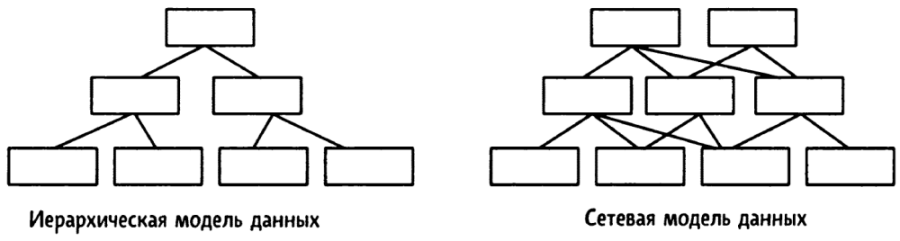
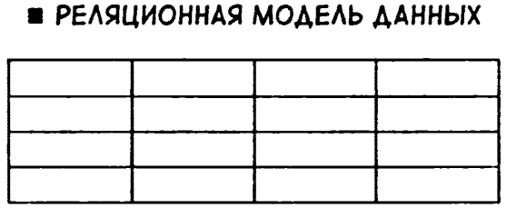
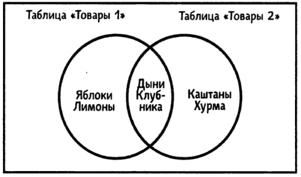
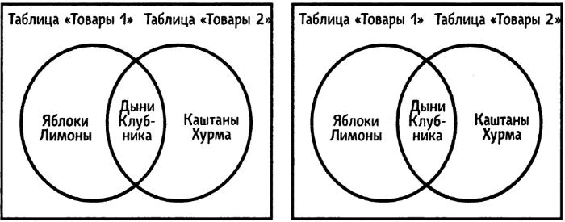
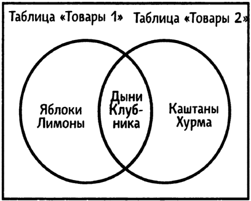
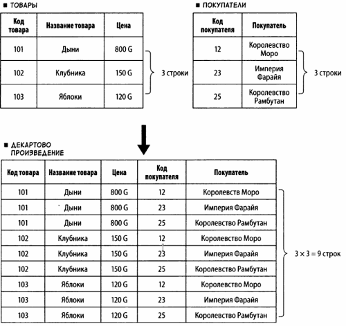
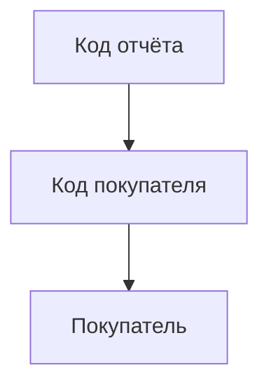
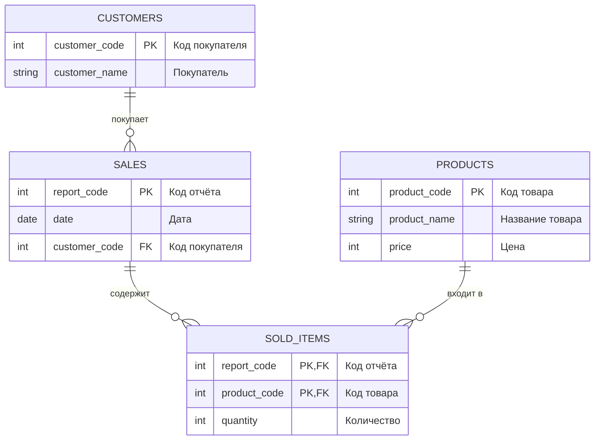
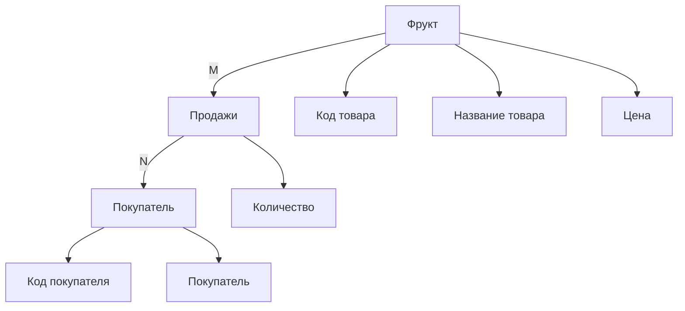

## Данные

- **Иерархическая модель** данных, в которой данные связанны в древовидную структуру
- **Сетевая модель** данных, в которой связи между данными могут пересекаться друг с другом
- **Реляционная модель** данных, в основе которой лежит привычная нам двумерная таблица объединяет в себе иерарическую и сетевую модели.



**Иерархическая модель** данных имеет элемент "потомок", которым имеет только одного "предка". Реляционная БД позволяет обрабатывать данные с помощью двумерной таблицы - простой и привычной для понимания концепции.

Реляционная модель данных:



Для примера возмём двумерную таблицу

```markdown
| Код товара | Название товара | Цена | Примечание |
----------------------------------------------------
|101         | Дыни            | 800  | С семечками|
|102         | Клубника        | 150  |            |
|103         | Яблоки          | 120  |            |
|104         | Лимоны          | 120  | Кислые     |
```


Записи, поля, уникальные данные. Отсутствие данных - NULL

- В реляционной модели данных таблица называется **отношением**
    - каждая строка является **записью**, она же блок данных.
    - столбец таблицы - это **поле**, которое является элементом данных
    - есть особое поле, которое называется **ключом** (например, код товара, который должен быть уникальным). **Первичный уключ** в таблице выше - это код товара
- Реляционная модель данных разработана таким образом, что можно обрабатывать с помощью математических операций.

Извлечение из таблицы столбца "Название товара" называется проекцией (PROJECTION). Есть ещё несколько операций (всего их **8**):
1. ОБЪЕДИНЕНИЕ (**UNION**)
1. ВЫЧИТАНИЕ (**DIFFERENCE**) - иногда называется разность
1. ДЕКАРТОВО ПРОИЗВЕДЕНИЕ (**CARTESIAN PRODUCT**)
1. ДЕЛЕНИЕ (**DIVISION**)
1. ПЕРЕСЕЧЕНИЕ (**INTER-SELECTION**)
1. ВЫБОРКА (**SELECT**)
1. СОЕДИНЕНИЕ (**JOIN**)
1. и уже известная нам Проекция (PROJECTION)

**Обработка данных** - основа реляционной модели данных, которая заключается в том, что обрабатывать данные можно сочетая эти восемь операций.

### Операции извлечения данных

Как нам уже известно, существует **8** основных операций и они разделяются на две категории: **теоретико-множественные** и **специальные реляционные**.

#### Теоретико-множественные операции

Теоретико-множественными операциями называют операции **объединения** (union), **вычитание** (difference), **пересечения** (intersection) и декартова произведения (Cartesian product). Эти операции работают с одной или несколькими группами строк для создания новой группы строк. В целом, они определяют, какие строки из входных данных появятся в выходных данных.

1. **ОБЪЕДИНЕНИЕ (UNION)**

Операция Объединение (UNION) позволяет выбрать все товары, входящие в таблицу товаров 1 и таблицу товаров 2.

```markdown
Товары 1                     Товары 2
| Название товара | Цена |   | Название товара | Цена |
--------------------------   --------------------------
| Дыни            | 800  |   | Дыни            | 800  |
| Клубника        | 150  |   | Клубника        | 150  |
| Яблоки          | 120  |   | Каштаны         | 200  |
| Лимоны          | 200  |   | Хурма           | 350  |
```

В результате получается другая таблица, приведённая ниже

```markdown
| Название товара | Цена |
--------------------------
| Дыни            | 800  |
| Клубника        | 150  |
| Яблоки          | 120  |
| Лимоны          | 200  |
| Каштаны         | 200  |
| Хурма           | 350  |
```

Операция объединения извлекает все строки из обеих таблиц и комбинирует их. На нижнем рисунке показано, как выглядят данные из двух таблиц после выполнения операции **UNION**



2. **ВЫЧИТАНИЕ (DIFFERENCE)**

Операция Вычитание (DIFFERENCE) извлекает строки только из одной таблицы. Например, с помощью этой операции можно извлечь <u>все товары из первой таблицы, которые не входят во вторую таблицу</u>. Результаты зависят от того, в какой таблице находятся извлекаемые строки и в какой таблице находятся исключаемые строки.

Исходные таблицы
```markdown
Товары 1                     Товары 2
| Название товара | Цена |   | Название товара | Цена |
--------------------------   --------------------------
| Дыни            | 800  |   | Дыни            | 800  |
| Клубника        | 150  |   | Клубника        | 150  |
| Яблоки          | 120  |   | Каштаны         | 200  |
| Лимоны          | 200  |   | Хурма           | 350  |
```
Результат
```markdown
| Название товара | Цена |  | Название товара | Цена |
--------------------------  --------------------------
| Яблоки          | 120  |  | Каштаны         | 200  |
| Лимоны          | 200  |  | Хурма           | 350  |
```
*Дыни и Клубника в результат не попали, т.к. разность множеств оставляет только те элементы Таблицы 1, которых нет в Таблице 2.



Чтобы не путаться, таблицы **Товары 1** и **Товары 2** можно назвать **A** и **B** соответственно:

**«Разность A − B — это то, что остаётся от A, если убрать всё общее с B».**

Или короче:

**A − B = A минус (A ∩ B)**

То есть из **A** вычитается пересечение **A** и **B**. В примере:
- **A** = {Дыни, Клубника, Яблоки, Лимоны}
- **B** = {Дыни, Клубника, Каштаны, Хурма}
- **A** ∩ B = {Дыни, Клубника}
- **A** − B = {Яблоки, Лимоны}

3. **ПЕРЕСЕЧЕНИЕ (INTERSECTION)**

При помощи пересечения можно также извлекать товары, которые содержаться в <u>обеих таблицах</u>.

```markdown
| Название товара | Цена |
--------------------------
| Дыни            | 800  |
| Клубника        | 150  |
```



4. **ДЕКАРТОВО ПРОИЗВЕДЕНИЕ (CARTESIAN PRODUCT)**

Операция **CARTESIAN PRODUCT** комбинирует все строки двух таблиц. В этом примере мы получаем `3x3=9` строк.



#### Специальные реляционные операции

5. **ПРОЕКЦИЯ (PROJECTION)** <u>извлекает столбцы</u> из таблицы.

```markdown
| Название товара |
-------------------
| Дыни            |
| Клубника        |
| Яблоки          |
| Лимоны          |
```

**Проекция** - это извлечение по вертикали.

6. **ВЫБОРКА (SELECTION)**

Операция **SELECTION** извлекает две <u>строки</u> из таблицы

```markdown
| Название товара | Цена |
--------------------------
| Дыни            | 800  |
| Клубника        | 150  |
```

**Выборка** - это извлечение по горизонтали

7. **СОЕДИНЕНИЕ (JOIN)**

Операция **JOIN** обладает большими возможностями, которые относятся к работе по соединению таблиц.

```markdown
Товары                                   Продажи
| Код товара | Название товара | Цена |  | Дата  | Код товара | Количество |
---------------------------------------  ----------------------------------
| 101        | Дыни            | 800  |  | 01.11 | 102        | 1100       |
| 102        | Клубника        | 150  |  | 01.11 | 101        | 300        |
| 103        | Яблоки          | 120  |  | 05.11 | 103        | 1700       |
| 104        | Лимоны          | 200  |  | 08.11 | 101        | 500        |
```

*Таблица "Продажи" не содержит код 104

В этих двух таблицах столбцы "Код товара" дают нам информацию о товаре. Первого ноября было продано 1100 клубники (код товара 102). Таблица "Продажи" не содержит информации о названии товара, зато в ней есть столбец с кодом этого товара. Другими словами, благодаря ссылке на код товара, таблица "Продажи" позволяет нам понять, какой товар был продан. В данном случае "Код товара" - это первичный ключ в таблице "Товары" и внешний ключ в таблице "Продажи". В результате, объединяя две таблицы таким образом, чтобы внешний ключ ссылался на первичный ключ, получаем следущую таблицу:

```markdown
| Дата | Код товара | Название товара | Цена | Количество |
-----------------------------------------------------------
| 01.11 | 102       | Клубника        | 150  | 1100       |
| 01.11 | 101       | Дыни            | 800  | 300        |
| 05.11 | 103       | Яблоки          | 120  | 1700       |
| 08.11 | 101       | Дыни            | 800  | 500        |
```

8. **ДЕЛЕНИЕ (DIVISION)**

**DIVISION** извлекает строки, где значения в столбцах совпадают со значениями в столбцах во второй таблице, но при этом возвращает столбцы, которых нет во второй таблице

```markdown
Продажи                                  Покупатели
| Код покупателя | Покупатель | Дата  | | Код покупателя | Покупатель |
--------------------------------------  -------------------------------
| 12             | Дания      | 05.03 | | 12             | Дания      |
| 12             | Дания      | 10.03 | | 23             | Испания    |
| 23             | Испания    | 05.03 |
| 25             | Албания    | 21.03 |
| 30             | Камерун    | 25.03 |
```

В результате деления таблицы **"Продажи"** на таблицу **"Покупатели"** получаем результат в виде таблицы, которая позволяет нам найти дату отправки фруктов в оба направления: как в Испанию, так и в Данию:

```markdown
| Дата  |
| 05.03 |
```

В реляционной БД для извлечения данных можно использовать восемь различных операций. Извлёчённые данные представляются в виде временных таблиц. Если комбинировать операции, то можно извлекать данные с любыми целями. Например, используя цену товара можно получить сводные данные по валовой выручке от продажи. Реляционная БД потому и популярна, что обеспечивает гибкую обработку данных.

Ключевая идея: **SQL** - это интерфейс и язык, с помощью которого вы "говорите" с **СУБД**, а она переводит ваши команды в операции с бинарными файлами.

***

**ER (ENTITY-RELATIONSHIP)** - сущность-связь

Нормализация данных - когда существующая таблица не практичка

Сведённые данные всех отчётов в таблицу (сводная таблица, созданная на основе отчёта о продажах)

```markdown
| Код отчёта | Дата  | Код покупателя | Покупатель | Код товара | Название товара | Цена | Кол-во |
---------------------------------------------------------------------------------------------------
| 1101       | 05.03 | 12             | Дания      | 101        | Дыни            | 800  | 1100   |
|            |       |                |            | 102        | Клубника        | 150  | 300    |
| 1102       | 07.03 | 23             | Испания    | 103        | Яблоки          | 120  | 1700   |
| 1103       | 08.03 | 25             | Албания    | 104        | Лимоны          | 200  | 500    |
| 1104       | 10.03 | 12             | Дания      | 101        | Дыни            | 800  | 2500   |
| 1105       | 12.03 | 25             | Албания    | 103        | Яблоки          | 120  | 2000   |
|            |       |                |            | 104        | Лимоны          | 200  | 700    |
```

Какие проблемы у этой таблицы?

1. Дыни, например, в нескольких местах - если понадобится изменить цену дынь, то это придётся делать в нескольких строках
1. Повторяющиеся данные в таблице - это признак того, что надо разделить таблицу

Таблицы, которые имеют две или более одинаковые строки данных и которую из-за этого приходится делить, называются ненормализованные.

Таблица "Товары" относится только к товарам, чтобы имправить цену только в одной строке
```markdown
| Дыни     | 800 |
| Клубника | 150 |
| Яблоки   | 120 |
| Лимоны   | 200 |
```

Разделим на таблицу, в которой будут "дата", "код покупателя" и "покупатель".

Таблица "Продажи" (первая нормальная форма (1))
```markdown
| Код отчёта | Дата  | Код покупателя | Покупатель |
----------------------------------------------------
| 1101       | 05.03 | 12             | Дания      |
| 1102       | 07.03 | 23             | Испания    |
| 1103       | 08.03 | 25             | Албания    |
| 1104       | 10.03 | 12             | Дания      |
| 1105       | 12.03 | 25             | Албания    |
```
Таблица первой нормальной формы создаётся делением ненормаризованной таблицы

и на другую таблицу, где будут "название товара", "цена", "количество"

Таблица "Реализованные товары" (первая нормальная форма (2)) - данные о реализованных товарах
```markdown
| Код отчёта | Код товара | Название товара | Цена | Количество |
-----------------------------------------------------------------
| 1101       | 101        | Дыни            | 800  | 1100       |
| 1101       | 102        | Клубника        | 150  | 300        |
| 1102       | 103        | Яблоки          | 120  | 1700       |
| 1103       | 104        | Лимоны          | 200  | 500        |
| 1104       | 101        | Дыни            | 800  | 2500       |
| 1105       | 103        | Яблоки          | 120  | 2000       |
| 1105       | 104        | Лимоны          | 200  | 700        |
```

Теперь код отчёта есть в обеих таблицах, таким образом определяется связь между обеими таблицами

Таблица, получившаяся в результате такого разделения, называется таблицей первой нормальной формы.

Таблица, которая имеет строки с двумя или более одинаковыми данными и которую потом делят, называется ненормализованной формой. Это означает, что таблицы первой нормальной формы создаются делением ненормализированной формы.

В виде первой нормализованной формы таблицы ещё не могут использоваться как реляционные таблицы БД, потому, что если поступили, например, апельсины, то они в эту таблицу не могут попасть, т.к. ещё не проданы. Если апельсины ещё не продаты, значит нам не известны код отчёта и количество. К тому же в этой таблице перемешаны данные относящиеся к товарам и продажам.

Таким образом, используя таблицу (2) не возможно управлять данными независимо. Надо её разделить

Таблицы, которые получились в результате разделения табдицы первой нормальной формы (2) на две.

Таблица "Товары" (вторая нормализированная форма (1))
```markdown
| Код товара | Название товара | Цена |
---------------------------------------
| 101        | Дыни            | 800  |
| 102        | Клубника        | 150  |
| 103        | Яблоки          | 120  |
| 104        | Лимоны          | 200  |
```
Таблица (1) содержит данные, относящиеся к товарам. Если значение в столбце "код товара" определено, мы можем найти данные в столбцах "название товара" и "цена".

Определям "Первичный ключ"
```markdown
| Код отчёта | Код товара |
```

Делить таблицу нужно так, чтобы при определении первичного ключа значения в других столбцах были определены.

```markdown
  . . . . . . . . . . . . . . . . .
  .               V               V
| Код товара | Название товара | Цена |
```
   ^
 первичный ключ

```markdown
  . . . . . . . . . . . . . . . . .
  .               .               V
| Код отчёта | Код товара | Количество |
```

Таблица, которая получается в результате деления по такому правилу, называется таблицей второй нормальной формы.

Таблица "Реализованные товары" (вторая нормализованная форма (2))
```markdown
| Код отчёта | Код товара | Кол-во |
------------------------------------
| 1101       | 101        | 1100   |
| 1101       | 102        | 300    |
| 1102       | 103        | 1700   |
| 1103       | 104        | 500    |
| 1104       | 101        | 2500   |
| 1105       | 103        | 2000   |
| 1105       | 104        | 700    |
```
Код товара как первичный ключ, который определяет данные в других столбцах

Теперь можно добавить апельсины в таблицу (1) второй нормальной формы. И если изменится цена на дыни, можно просто скорректировать данные всего в одной строке.

Снова таблица "Продажи" (первая нормальная форма (1))
```markdown
| Код отчёта | Дата  | Код покупателя | Покупатель |
----------------------------------------------------
| 1101       | 05.03 | 12             | Дания      |
| 1102       | 07.03 | 23             | Испания    |
| 1103       | 08.03 | 25             | Албания    |
| 1104       | 10.03 | 12             | Дания      |
| 1105       | 12.03 | 25             | Албания    |
```
   ^             ^           ^               ^
   .             .  .  . . . . . . . . . . . .
   .                     .
   .                     .
 первичный ключ связан c .

Для такой таблицы, если одно значение в столбце определено, то данные в других столбцах тоже определены.

Таблицу, в которой значения в других столбцах определены когда определён первичный ключ, можно считать таблицей второй нормальной формы

Таблица "Продажи" (вторая нормальная форма (3))
```markdown
| Код отчёта | Дата  | Код покупателя | Покупатель |
----------------------------------------------------
| 1101       | 05.03 | 12             | Дания      |
| 1102       | 07.03 | 23             | Испания    |
| 1103       | 08.03 | 25             | Албания    |
| 1104       | 10.03 | 12             | Дания      |
| 1105       | 12.03 | 25             | Албания    |
```
Но в этой таблице есть один недостаток - мы не може управлять покупателями!

В таблице "Продажи" (вторая нормальная форма (3)) покупатель определён согласно коду отчёта. Определение кода покупателя определякет значение в столбце "код покупателя", тем самым косвенно опеределяя покупателя.



Чтож, придётся снова разделить таблицу, т.к. часто первая и вторая нормализованные формы таблиц являются промежуточными перед окончательным вариантом проектируемой БД.

Таблица "Продажи" (третья нормальная форма (1))
```markdown
| Код отчёта | Дата  | Код покупателя |
---------------------------------------
| 1101       | 05.03 | 12             |
| 1102       | 07.03 | 23             |
| 1103       | 08.03 | 25             |
| 1104       | 10.03 | 12             |
| 1105       | 12.03 | 25             |
```

Таблица "Покупатели (третья нормальная форма (2))"
```markdown
| Код покупателя | Покупатель |
| 12             | Дания      |
| 23             | Испания    |
| 25             | Албания    |
```

Таблица "Реализованные товары"
```markdown
| Код отчёта | Код товара | Количество |
----------------------------------------
| 1101       | 101        |   1100     |
| 1101       | 102        |   300      |
| 1102       | 103        |   1700     |
| 1103       | 104        |   500      |
| 1104       | 101        |   2500     |
| 1105       | 103        |   2000     |
| 1105       | 104        |   700      |
```

Таблица "Торвары"
```markdown
| Код товара | Название товара | Цена |
---------------------------------------
| 101        | Дыня            | 800  |
| 102        | Клубника        | 150  |
| 103        | Яблоко          | 120  |
| 104        | Лимон           | 200  |
```
Всё эти три таблицы получились в результате разделения таблицы до третьей нормальной формы.

Эти таблицы только с виду кажутся отдельными и независимыми друг от друга. На самом деле их крепко объединяют внешние ключи.


**Код покупателя** в таблице "Продажи" ссылается на **код покупателя** в таблице "Покупатель", таким образом **код товара** в таблице "Реализованные товары" ссылается на **код товара** в таблице "Товары" и **код отчёта** в таблице "Реализованные товары" ссылается на **код отчёта** в таблице "Продажи". Таким образом могут быть реализованы связи между таблицами в реалиационной базе данных оп ER-модели (ER - сущьность-связь).



Обычно в реалиационных БД используют таблицы, разделённые до третьей нормальной формы.

Теперь, управляя таблицами, вы можете работать с товарами, покупателями и продажами и делать это без каких-либо проблем. Никаких противоречий не возникнет при добавлении данных.

Таким образом мы разделимли первоначальную таблицу на несколько дополнительных таким образом, что все первоначальные данные входят во все получившиеся таблицы.

Таблица, показывающая отношения между данными называется реляционной.




> Если вы обнаружили ошибку в этом тексте - сообщите пожалуйста автору!